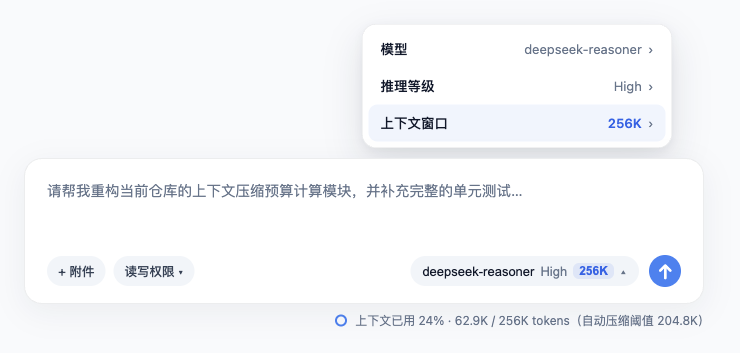
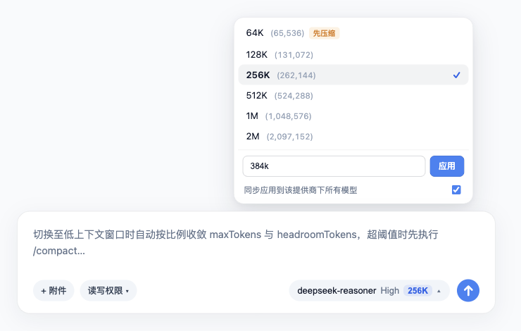
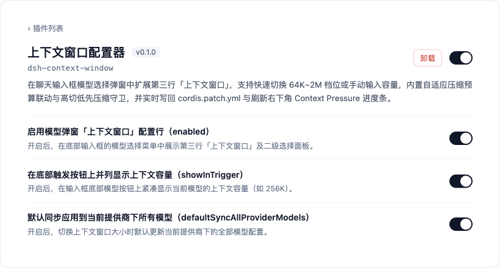
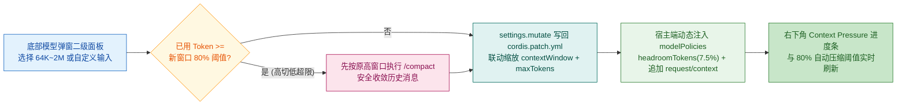

# dsh-context-window

**DeepSeek Harness (DSH) 上下文窗口手动配置与自适应压缩防失败守卫插件**（Manual Context Window Selector & Adaptive Compaction Guard for DeepSeek Harness）。

在底部聊天输入框的模型选择下拉弹窗中，原汁原味扩展第三行 **【上下文窗口】（Context window）** 及二级配置面板（`64K` / `128K` / `256K` / `512K` / `1M` / `2M` + 手动自定义输入），支持直接写回 `cordis.patch.yml`、实时刷新当前会话的右下角 **Context Pressure** 进度条，并内置**自适应压缩预算联动**与**「高切低先自动压缩再降窗」三层防失败保护**。

---

## ✨ 核心特性 (Features)

1. **原生插槽无损接管（Slot Shadowing）**
   - 基于 DSH 客户端插槽（`conversation.input.model`）的 `priority: -10` 优先级选举机制无损接管底部模型选择菜单，保留 100% 原生模型搜索、分组置顶与推理等级（Effort）交互；禁用或卸载插件后自动无感回退至内置组件，零侵入 `app.asar`。
2. **一级菜单第三行「上下文窗口」+ 底部触发按钮容量徽标**
   - 在模型弹窗一级菜单（`pane === "root"`）的「模型」与「推理等级」下方追加第三行 **「上下文窗口」（Context window）**，实时展示当前选中模型的上下文容量（如 `64K`、`128K`、`256K`、`512K`、`1M`、`2M`）。
   - 支持在底部模型触发按钮（`trigger`）上并列紧凑展示当前上下文容量（可在插件设置中独立开关）。
3. **二级预设档位 + 任意自定义容量输入 + 提供商级批量同步**
   - 点击「上下文窗口」进入二级面板（`pane === "context"`），提供 `64K` ~ `2M` 六档常用预设。
   - 底部支持手动输入任意正整数（如 `300000`）或带 `k/m` 单位简写（按 1024 进制换算，如 `256k`、`500k`、`1.5m`），按 `Enter` 或点击「应用」立即生效。
   - 内置 **「同步应用到该提供商下所有模型」** 复选框（默认开启），一键统一同一 Provider 下所有模型的上下文容量。
4. **三层自适应压缩防失败守卫（Adaptive Compaction Guard）**
   - **消除低窗口预算倒挂（`TargetPressureConfigError`）**：DSH 内置 `compaction-basic` 默认预留 `32K/256K (maxTokens) + 64K (headroomTokens)`，直接将模型改小到 `64K` 或 `128K` 会导致 `pressureBudgetTokens <= 0` 而使 80% 预防性自动压缩失效。本插件自动按窗口容量的 `12.5%` 收敛模型 `maxTokens`、按 `7.5%` 动态注入 `compaction.config.modelPolicies` 的 `headroomTokens` 与 `maxTokens`（调回大窗口时自动恢复默认），确保任意小窗口下 80% 自动压缩精准触发。
   - **高切低「先压缩再降窗」保护**：当从高窗口切向低窗口且当前会话已用 Token 超过目标低窗口的 80% 阈值时，二级面板自动标记 **`先压缩`（`Auto-compact`）** 徽标，并在写入低窗口配置前先在原高窗口预算下自动执行 `/compact` 压缩历史对话。
   - **宿主端 `requestHeader` 残留钳制与进度条即时同步**：自动钳制上一轮大窗口遗留的 `requestHeader.config.maxTokens`，并在模型或窗口变更时立即向活跃会话追加 `"request/context"` 事件，无需等待下一轮发消息即可刷新右下角 Context Pressure 进度条分母。

---

## 📸 实机运行截图 (Screenshots)

### 1. 模型选择弹窗一级菜单新增第三行「上下文窗口」与底部容量标签


### 2. 二级面板：64K~2M 预设档位、「先压缩」智能徽标、自定义输入与提供商批量同步


### 3. 插件可视化设置面板


---

## 🏗️ 运行时架构与自适应预算公式 (Architecture & Budget Math)



| 预设档位 | `contextWindow` (Tokens) | 自适应 `maxTokens` (`12.5%`) | 自适应 `headroomTokens` (`7.5%`) | 剩余消息预算 (`pressureBudgetTokens`) | 80% 自动压缩触发线 (`thresholdTokens`) |
| :--- | :--- | :--- | :--- | :--- | :--- |
| **`64K`** | `65,536` | `8,192` (`8K`) | `4,915` (`~4.8K`) | `52,429` | **`52,428`** (`80%`) |
| **`128K`** | `131,072` | `16,384` (`16K`) | `9,830` (`~9.6K`) | `104,858` | **`104,857`** (`80%`) |
| **`256K`** | `262,144` | `32,768` (`32K`) | `19,660` (`~19.2K`) | `209,716` | **`209,715`** (`80%`) |
| **`512K`** | `512 × 1024` | `65,536` (`64K`) | `39,321` (`~38.4K`) | `419,431` | **`419,430`** (`80%`) |
| **`1M`** | `1,048,576` | `65,536` (`64K`) | `65,536` (`64K`) | `917,504` | **`838,860`** (`80%`) |
| **`2M`** | `2,097,152` | `65,536` (`64K`) | `65,536` (`64K`) | `1,966,080` | **`1,677,721`** (`80%`) |

---

## 📦 安装与使用 (Installation)

### 方式一：通过 npm 安装
```bash
npm install dsh-context-window
```

### 方式二：在 DeepSeek Harness Profile 中配置启用
在 Profile 的 `package.json` 中添加 `"dsh-context-window"` 依赖与 `dsh.profile.bundles` 项，并在 `cordis.patch.yml` 中声明：

```yaml
- id: context-window
  name: dsh-context-window
  config:
    enabled: true
    showInTrigger: true
    defaultSyncAllProviderModels: true
```

---

## ⚙️ 配置项说明 (Configuration)

| 配置项 | 类型 | 默认值 | 说明 |
| :--- | :--- | :--- | :--- |
| `enabled` | `boolean` | `true` | 是否在底部聊天输入框的模型选择弹窗中启用第三行「上下文窗口」配置功能 |
| `showInTrigger` | `boolean` | `true` | 是否在底部模型触发按钮上并列紧凑显示当前模型的上下文窗口容量（如 `256K`） |
| `defaultSyncAllProviderModels` | `boolean` | `true` | 打开二级面板时，「同步应用到该提供商下所有模型」复选框的默认勾选状态 |

---

## 🧪 运行单元测试 (Testing)

```bash
npm test
```

## 📄 开源协议 (License)

[MIT](./LICENSE) © xt765
